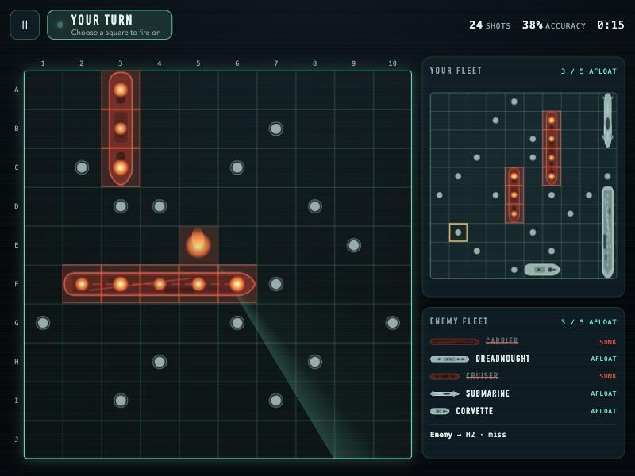

# Ironwake

A naval strategy game for iPad: hunt the enemy fleet on a 10 × 10 sonar grid.
Solo against three computer opponents, or two-player pass-and-play on one device.

**Play:** https://georgephilippou.github.io/ironwake/

Install on iPad: open the link in Safari → Share → **Add to Home Screen**. It then
runs full-screen and works offline.

## Themes and historical battles

Settings → Theme (or the flag button on the title screen) switches between the
original **Sonar** console and **Historical**: three real wars of the Royal Navy,
where each player commands one side with ships that served in that war.

| Battle | Royal Navy | Opponent |
| --- | --- | --- |
| Trafalgar, 1805 | HMS Victory, Temeraire, Euryalus, Naiad, Pickle | Marine Impériale: Bucentaure, Redoutable, Hermione, Hortense, Argus |
| Second World War | HMS Ark Royal, Warspite, Belfast, Upholder, Gladiolus | Kriegsmarine: Bismarck, Scharnhorst, Prinz Eugen, U-47, S-38 |
| Falklands, 1982 | HMS Hermes, Invincible, Sheffield, Conqueror, Ardent | Armada Argentina: ARA 25 de Mayo, General Belgrano, Hércules, Santa Fe, Guerrico |

Every ship is drawn as a period plan (sail, Western Approaches and Baltic
camouflage, 1982 grey) under its own flag; each battle has its own look, words
and sounds, in day and night versions. Germany is shown with the Balkenkreuz,
not the swastika war ensign. On two iPads the host picks the battle and side and
the other iPad takes the opposite side. Code: `js/skins.js` (roster and words),
`js/art.js`, `js/audio.js` and the historical sections of `css/style.css`.

## Two iPads

Each player can use their own iPad. One chooses **Two iPads → Host a game** and
reads out the four-letter room code; the other chooses **Join a game** and types
it in. Both iPads should be on the same Wi-Fi.

How it connects: the free public [PeerJS](https://peerjs.com) broker introduces
the two iPads using the room code, then the game runs over a direct WebRTC
connection between them. The broker sees only the room code and the devices'
network addresses — never the game. Each iPad keeps its own fleet; a ship's
position is only sent to the other iPad when it is sunk, and the winner's
remaining ships are revealed at the end. If an iPad sleeps or the app is closed,
the game reconnects and carries on (`js/online.js` explains how).

For testing on one computer, open the game as `localhost` in one tab and
`127.0.0.1` in another (separate storage), or add `?net=local` to both to link
two tabs without the internet.

## What's here

Plain HTML, CSS and JavaScript modules — no build step, no dependencies.

| Path | What it is |
| --- | --- |
| `index.html`, `css/style.css` | Page shell and the whole visual design (dark "night watch" and light "day chart") |
| `js/engine.js` | Rules: placement, firing, sinking, win detection |
| `js/ai.js` | Easy (random), Normal (hunt and target), Hard (probability density) |
| `js/game.js` | Match state machine; save/restore validation |
| `js/app.js` | Screens, drag-and-drop, animation sequencing |
| `js/art.js`, `js/fx.js`, `js/audio.js` | SVG artwork, canvas effects, Web Audio sound synthesis |
| `js/online.js`, `js/net.js`, `vendor/peerjs.min.js` | Two-iPad protocol (pure, tested) and the WebRTC link (PeerJS 1.5.4, MIT) |
| `js/storage.js` | Settings, statistics and the saved game (localStorage) |
| `sw.js`, `manifest.webmanifest`, `icons/`, `splash/` | Offline support and home-screen install |
| `tests/` | Automated tests (`npm test`, needs Node 20+) |

## Releasing a change

```bash
npm run stamp   # rewrites the version hash + offline file list in sw.js
npm test        # fails if the stamp is stale, so you can't forget
```

Then commit and push. Installed copies pick up the new version the next time
they are opened online: the new service worker downloads a complete fresh copy,
swaps over, and the app reloads itself (or offers a "tap to reload" if a battle
is in progress — the game in progress is kept).

`python3 tools/make-art.py` regenerates the icon PNGs and iPad launch images from
`icons/icon.svg` (needs `rsvg-convert`). Only needed if the artwork changes.

All artwork and sound is original: ships and icons are hand-written SVG, and every
sound effect is synthesised at runtime with the Web Audio API.


